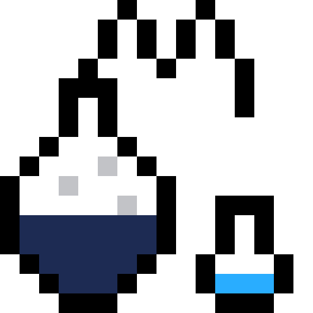

<p align="center">
  
</p>

# Distill

A desktop workspace for AI agents. Bring your models together to plan, execute,
and review work, with projects, memory, and benchmarks in one place.

[Get started](#get-started) · [Documentation](#documentation) · [License](LICENSE)

## Work with a team of agents

- **Orchestrate tasks.** A conductor breaks work into steps, delegates to agents,
  and reviews their results.
- **Choose your models.** Pin a model for a task or use routing informed by
  benchmark results.
- **Compare what works.** Evaluate models and workflows on your own tasks.
  Inspect results, execution time, and reported usage and cost.
- **Keep your context.** Organize work into projects, reuse agents and skills,
  and carry editable memory and project knowledge across sessions.

Connect your favorite AI providers.

Your chats, settings, and project records are stored locally.

## Get started

Distill runs on **Windows**. To build and run it from source, install
[Git](https://git-scm.com/downloads/win) and
[just](https://just.systems/man/en/packages.html), then open PowerShell:

```powershell
git clone https://github.com/ilezhnin/distill-code.git
cd distill-code
just bootstrap-windows install
just setup-windows
just dev-windows
```

Bootstrap installs the required development tools. If it updates your PATH,
open a new PowerShell in the repository before continuing.

Once the app opens, connect a provider, add your project, and start a chat.

For prerequisites, setup without `just`, troubleshooting, or building an
installer, see the [Windows setup guide](docs/windows-onboarding.md).

## Documentation

- [Provider accounts](docs/provider-accounts.md)
- [Benchmarks and model selection](docs/benchmark-authoring.md)
- [Local data and storage](docs/distill-root-layout.md)
- [Development guide](AGENTS.md)

Built with Tauri 2, React 19, and Rust. Licensed under [Apache 2.0](LICENSE).
