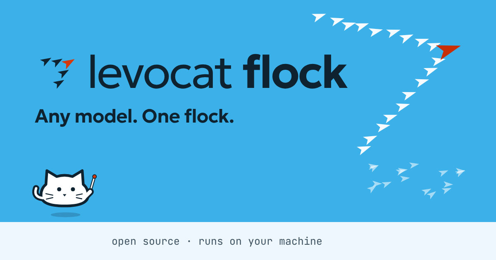

<p align="center">
  <a href="https://www.levocat.com/flock/"></a>
</p>

<p align="center">
  <a href="https://github.com/ilezhnin/distill-code/actions/workflows/ci.yml"></a>
  <a href="LICENSE"></a>
  <a href="package.json"></a>
  
  <a href="https://www.levocat.com/flock/"></a>
</p>

# Levocat Flock

**No single model is best at everything. A flock does not need one.**

Levocat Flock is an open-source development environment where models from
different providers work as a team. Small squads take a task apart in
parallel, and the steps that depend on them see every report that came
before. A conductor holds the shape: it breaks the task into steps, gives
every step a class of work, and hands that step to the model that has earned
it.

[Website](https://www.levocat.com/flock/) ·
[Get started](#get-started) ·
[How a task flies](#how-a-task-flies) ·
[Documentation](docs/README.md) ·
[Contributing](CONTRIBUTING.md)

## What's inside

- **Many harnesses, one host.** Agent harnesses from different providers run
  side by side in one desktop app: Claude Code, Codex, Grok, Kimi Code, Z.ai
  (GLM through OpenCode), Copilot, and Amp. Choose one per chat, or let the
  conductor mix them inside a single task.
- **Work in waves.** Steps that can run in parallel fly together. The flock
  regroups before the next wave, so results build on each other.
- **Agents name the work, not the model.** An agent is a plain Markdown file
  with a short frontmatter that points at a class of work rather than a
  model. Whichever model has earned that class does the job. Want a specific
  model? Pin it in the file, and the pin wins.
- **Memory that lasts.** Projects, history, editable memory, and project
  knowledge carry across sessions, so you resume work with its context intact.
- **Benchmarks built in.** Compare models and whole workflows on your own
  tasks by quality, execution time, and reported usage and cost.
- **Local by default.** Chats, settings, and project records stay on your
  machine. You choose which providers your agents work with.

## How a task flies

You ask for something in a conductor chat. The conductor either answers
itself or writes a plan of up to five steps. Each step names a role, a
subtask, and what it may see of the others' work: nothing, so it starts at
once and flies in parallel with its siblings, or every report that came
before it, so it waits for them.

```text
reports-app · conductor
> Add CSV import to the reports page.

#  role      class of work     sees        subtask
1  brigade   Implementation    nothing     Write the streaming CSV parser.
2  brigade   Frontend and UI   nothing     Build the upload dialog.
3  acceptor  Testing           steps 1-2   Review both parts and run the tests.
```

Steps 1 and 2 fly at once. Step 3 waits for their reports and checks the
work. Every step resolves to a class of work, and the model that has earned
that class takes it. When the wave lands, the conductor reads the digest of
reports and gives a verdict: accept, revise (at most twice), or hand the
question to you. A wave that produced something checkable is not accepted
until a verification step has checked it, and a report that names files which
are not on disk is not accepted at all. The whole protocol is written down in
[the waves contract](LAWS/WAVES.md).

**See every bird in the flock.** Under each message you see who worked on it:
the conductor, its orchestrators, their subagents, each with a live status,
its model, and its spend. Open any one and its chat opens in a tab beside
yours. The sidebar shows the agent tree at every depth.

## The lead is earned, not assigned

You do not have to rank models by hand. Flock benchmarks them on your own
tasks, and once a class of work has a certificate, a certified selector
decides who leads it. Until then your own fallback order decides, and the app
records why each choice was made.

| | |
| --- | --- |
| **Measure** | Run models and workflows on your own tasks, not on someone else's leaderboard. Quality, time, usage, cost. Evaluations run in an isolated Linux sandbox on your machine. |
| **Certify** | A selection rule is fixed before the run and checked on held-out cases. It earns a certificate only if the evidence passes, and loses it when the evidence stops holding. Preregistered, held-out, revocable. |
| **Route** | A certified selector picks the model for every step, class by class. Where nothing is certified yet, your own order decides. |
| **Pin** | Want a specific model on a task? Pin it. A pin always wins over the selector. |

Missing measurements are shown as unknown, never as a claim. The operator's
guide is [Operating benchmarks and learned routing](docs/benchmark-operations.md);
task and evaluator contracts are in [Benchmark authoring](docs/benchmark-authoring.md).

## Why

Two ICLR 2026 papers from Sakana AI, [Trinity](https://arxiv.org/abs/2512.04695)
and [Conductor](https://arxiv.org/abs/2512.04388), showed that a small
coordinator can get more out of a team of models than any one of them gives
alone. Flock brings that idea into everyday development. The plain-words
retelling, with turn-based tactics, raid leaders, and fog of war, is on the
blog: [The smallest one in the room is in charge](https://www.levocat.com/blog/the-smallest-one-is-in-charge/).

Levocat Flock is an independent project and is not affiliated with the
papers' authors.

## Get started

Flock runs on **Windows**. To build and run it from source, install
[Git](https://git-scm.com/downloads/win) and
[just](https://just.systems/man/en/packages.html), then open PowerShell:

```powershell
git clone https://github.com/ilezhnin/distill-code.git
cd distill-code
just bootstrap-windows install
just setup-windows
just dev-windows
```

Bootstrap installs the required development tools. If it updates your PATH,
open a new PowerShell in the repository before continuing. `just bundle`
builds an installer.

Once the app opens:

1. Connect a provider in Settings. Subscription accounts sign in through the
   provider's own flow in the browser or terminal; API accounts take a key.
2. Add a project and start a chat with one agent.
3. Start a conductor chat to fly a bigger task in waves, and watch who is
   working under each message.

For prerequisites, running the scripts without `just`, troubleshooting, and
installer details, see the [Windows setup guide](docs/windows-onboarding.md).
Provider specifics are in [Provider accounts](docs/provider-accounts.md).

## Documentation

The [documentation index](docs/README.md) maps every guide by audience. The
short list:

| Guide | For |
| --- | --- |
| [Windows setup](docs/windows-onboarding.md) | Running and building the app |
| [Provider accounts](docs/provider-accounts.md) | Connecting the harnesses, usage limits, and automatic account switching |
| [Waves: the conductor's contract](LAWS/WAVES.md) | How plans, reports, and verdicts work |
| [Operating benchmarks and learned routing](docs/benchmark-operations.md) | Measuring, certifying, and routing |
| [Data storage](docs/distill-root-layout.md) | What lives under `~/.distill` |
| [Contributor guide](AGENTS.md) | Working rules, code map, and the validation gate |

## Project status

- **Early.** Version 0.6.2, built from source; there are no packaged releases
  yet. Expect rough edges and read the laws in [LAWS/](LAWS/README.md) for what
  the product promises.
- **Windows only.** The host is a Tauri 2 app with a Rust agent host and a React
  renderer, in English and Spanish. Benchmarks evaluate inside a WSL Linux
  sandbox.
- **Still called Distill inside.** Flock grew out of a project named Distill.
  The window title, the `distillctl` and `distill-monitor` tools, the
  `~/.distill` data root, and the `distill-*` protocol blocks still carry that
  name while the code base is renamed. The guides say "Distill" wherever they
  describe the current build literally.

## Contributing

Read [CONTRIBUTING.md](CONTRIBUTING.md) for the short path from a clone to a
pull request, and [AGENTS.md](AGENTS.md) for the complete contributor guide.
Security problems go through [SECURITY.md](SECURITY.md), not a public issue.

## Origins and license

Flock started as a fork of [Berd](https://github.com/block/berd) by Block and
has since been rebuilt around waves, classes of work, and benchmarks by
[Ivan Lezhnin](https://www.levocat.com/). The original work is Block's. The
project is licensed under [Apache 2.0](LICENSE). Built with Tauri 2, React 19,
Rust, and the Agent Client Protocol.
